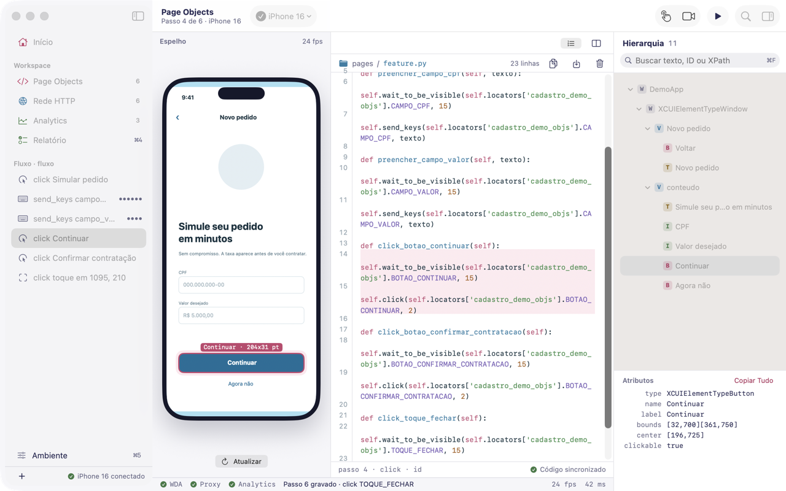

# Mo baile

[](https://github.com/francisco-efjr/mo-baile/actions/workflows/ci.yml)
[](LICENSE)


Inspetor de UI, espelho ao vivo, interceptador de rede, auditor de tagueamento
e gerador de Page Objects para automação mobile em iOS e Android. App nativo
para macOS.

Feito para quem escreve teste automatizado e cansou de esperar dez segundos por
uma captura estática no Appium Inspector.

> **Produto em desenvolvimento (beta).** O Mo baile já faz bastante coisa, mas
> ainda tem bugs e algumas telas vão mudar. Se algo falhar, relate pelo próprio
> app (**Ajuda › Relatar um Problema…** ou o selo **Beta** na barra de status)
> ou [abra uma issue](https://github.com/francisco-efjr/mo-baile/issues/new/choose).



## Recursos

- **Espelho ao vivo.** Streaming contínuo da tela do aparelho ou simulador,
  com detecção de mudança: quadro idêntico não é redesenhado.
- **Inspeção de hierarquia.** Árvore de acessibilidade normalizada entre
  Android e iOS, com busca e painel de atributos.
- **Toque repassado.** Clique no espelho vira toque no aparelho, na coordenada
  certa.
- **Geração de código.** Cada elemento inspecionado vira Page Object e ação
  Appium, em três estratégias de localizador (posição, XPath, id).
- **Inspeção de rede.** Proxy local que registra o tráfego HTTP do aparelho,
  com credenciais redigidas. Com o app em debug, lê HTTPS sem proxy: pelo cabo
  no iPhone (`CFNETWORK_DIAGNOSTICS`) e pelo logcat no Android (log do OkHttp).
- **Captura de tagueamento.** Eventos de Firebase Analytics em tempo real, via
  logcat no Android e Unified Logging no iOS.
- **Relatório de tagueamento.** Audita os eventos capturados, ou um log
  exportado, contra a spec dos cards, parâmetro por parâmetro, e exporta board
  Excalidraw, HTML, Markdown e TSV. Funciona sem aparelho.
- **Busca em tudo.** URL, headers, corpos, eventos e hierarquia.

## Requisitos

Na primeira abertura, a tela **Início** do app mostra o que está pronto e o que
falta instalar nesta máquina, com "Instalar no Terminal…" para cada item. O
levantamento completo, por recurso e com o caminho para Windows, está em
[docs/INSTALACAO.md](docs/INSTALACAO.md).

| Para | Precisa de |
|---|---|
| Abrir o app | Mac com Apple Silicon (M1 ou mais novo) e macOS 14 (Sonoma) ou superior. Mac com Intel ainda não roda o app |
| Motor | Python 3.10 ou superior com `Pillow` e `requests` (`python3 -m pip install Pillow requests`) |
| Android | `adb` ([Android SDK Platform Tools](https://developer.android.com/tools/releases/platform-tools)); emulador ou aparelho com depuração USB |
| iOS (simulador e iPhone) | Xcode completo (as Command Line Tools não têm o simulador), Node.js e [Appium](https://appium.io) com o driver XCUITest (`appium driver install xcuitest`) para subir o WebDriverAgent |
| Tagueamento de iPhone físico por cabo | opcional: `pymobiledevice3` no mesmo Python do motor |
| Relatório a partir de log exportado | nada além do app |

O app procura o Python nesta ordem: `MOBAILE_PYTHON` (variável de ambiente),
o Python do Mo baile em `~/Library/Application Support/Mo baile/python` (criado
pelo "Instalar no Terminal…" do Início, ou por
`bash tools/setup/instalar-mac.sh python`), `/opt/homebrew/bin/python3`,
`/usr/local/bin/python3` e `/usr/bin/python3`. O `python3` que vem com o macOS
é antigo demais, e o do Homebrew recusa `pip install` fora de um ambiente
virtual; o Python do Mo baile resolve os dois casos.

## Instalação

Precisa de um Mac com Apple Silicon (M1 ou mais novo) e macOS 14 ou mais novo.

### Com um comando (recomendado)

Abra o **Terminal** (Aplicativos › Utilitários), cole a linha abaixo e tecle
Return:

```bash
curl -fsSL https://raw.githubusercontent.com/francisco-efjr/mo-baile/main/tools/instalar.sh | bash
```

O [instalador](tools/instalar.sh) faz isto, em menos de um minuto:

- confere o Mac;
- baixa o zip do último release e confere o SHA-256;
- instala em **Aplicativos**. Numa conta que não é de administrador, instala em
  `~/Applications`, sem pedir senha;
- monta o Python do Mo baile com Pillow e requests;
- sobe o motor para conferir e abre o app.

Não precisa de Homebrew nem de senha. O macOS também não mostra o aviso de "não
pôde verificar": o Gatekeeper só confere arquivos com o atributo de quarentena,
que o navegador grava no download e o `curl` não grava. A confiança é a mesma
de um zip baixado daqui (veja o aviso abaixo). Se algo der errado, o instalador
para e diz o que fazer. Rodar de novo continua de onde parou e também atualiza.

### Pelo zip

1. Baixe `MoBaile-X.Y.Z-macOS.zip` na página de
   [Releases](https://github.com/francisco-efjr/mo-baile/releases/latest).
2. Confira a integridade (opcional, recomendado):

   ```bash
   shasum -a 256 -c MoBaile-X.Y.Z-macOS.zip.sha256
   ```

3. Descompacte e arraste `Mo baile (nativo).app` para **Aplicativos**. Não abra
   o app direto da pasta Downloads.
4. Abra o app. Na primeira vez, o macOS bloqueia (veja o aviso abaixo). Depois,
   a tela **Início** diz o que falta instalar. O mais comum é o Python, que o
   próprio app instala pelo Terminal.

### Atualizações

Com o app aberto, ele confere a cada duas horas se há versão nova publicada
aqui. Se houver, mostra uma faixa no topo da janela e uma notificação do macOS
com **Atualizar**. Atualizar baixa o zip e confere a assinatura do release
(`.sig`), enquanto você continua usando o app. Depois, **Reiniciar e
Atualizar** troca o app em Aplicativos e o abre de novo já atualizado
([ADR 0008](docs/adr/0008-atualizacao-no-lugar.md)). Isso vale a partir da
3.26.0. Quem está numa versão anterior atualiza uma vez à mão: baixe o zip,
feche o Mo baile e troque o app na pasta Aplicativos.

**Mo baile › Buscar Atualizações…** confere na hora. A consulta e o download
são as únicas chamadas de rede do app, não levam nenhum dado seu, e dá para
desligar a consulta em *Ajustes › Geral*. Depois de atualizar, o macOS pode
pedir de novo as permissões do app (o app ainda não tem assinatura da Apple).

### Aviso: o app não é notarizado

O Mo baile ainda sai com assinatura **ad-hoc**, sem Developer ID e sem
notarização da Apple. Quem baixa o zip pelo navegador, ou recebe o app pelo
Slack, por e-mail ou por AirDrop, vê na primeira abertura "A Apple não pôde
verificar se o item … está livre de malware", só com **Mover para o Lixo** e
**OK**. Desde o macOS 15, o clique direito › Abrir não libera mais o app. Para
abrir, escolha **um** caminho:

- Use o [instalador de um comando](#com-um-comando-recomendado).
- Tente abrir o app uma vez e clique em **OK**. Vá em *Ajustes do Sistema* >
  *Privacidade e Segurança*, role até a mensagem sobre o Mo baile, clique em
  **Abrir Mesmo Assim** e confirme com a senha do Mac. O botão fica
  disponível por cerca de uma hora depois da tentativa
  ([página da Apple](https://support.apple.com/pt-br/102445)).
- Ou remova o atributo de quarentena pelo Terminal:

  ```bash
  xattr -dr com.apple.quarantine "/Applications/Mo baile (nativo).app"
  ```

**O risco:** a notarização é a checagem automática da Apple contra malware
conhecido, e a quarentena é o que faz o Gatekeeper exigir essa checagem. Ao
pular as duas, você confia apenas na origem do arquivo. Faça isso só com o zip
baixado da página oficial de Releases deste repositório e com o SHA-256
conferido. Se preferir não confiar no binário, [compile do
código](#compilar-do-código): o resultado é o mesmo app, assinado na sua
máquina.

## Compilar do código

Precisa das Command Line Tools do Xcode (`xcode-select --install`); o Xcode
completo é opcional (sem ele, a cor de destaque usa a do sistema).

```bash
git clone https://github.com/francisco-efjr/mo-baile.git
cd mo-baile
make setup          # .venv com motor e ferramentas, e hooks do git
make check          # lint, varredura de segurança e suítes Python
make test-swift     # suíte do front nativo
make update-native  # empacota em /Applications/Mo baile (nativo).app e verifica
```

`make update-native` roda `swift test`, compila em release, monta o bundle num
diretório temporário, assina ad-hoc e só então troca o app instalado. Ele
recusa rodar com o app aberto. Para empacotar em outro lugar:
`DEST_DIR="$PWD/dist" bash tools/package_macos_app.sh`. Detalhes em
[docs/RELEASE.md](docs/RELEASE.md).

Copie `.env.example` para `.env` para ajustar portas, URLs do Appium e do
WebDriverAgent e o caminho do `adb`. Todos os valores têm padrão seguro. Mantenha
`PROXY_HOST=127.0.0.1`: escutar em `0.0.0.0` transforma a máquina em proxy
aberto para a rede local.

Todos os alvos: `make help`.

## Arquitetura

- `engine/` é um motor Python headless; toda a lógica de inspeção, automação e
  interceptação mora nele.
- `apps/MoBaile/` é o front SwiftUI: desenha estado e traduz gesto em chamada.
- Os dois conversam por JSON-RPC 2.0 sobre stdin/stdout
  ([docs/PROTOCOLO_RPC.md](docs/PROTOCOLO_RPC.md)).
- O motor é empacotado dentro do `.app` e roda no Python do sistema.
- Uma regra que aparece em Python e em Swift é defeito: o porquê está em
  [docs/ARQUITETURA.md](docs/ARQUITETURA.md) e nos [ADRs](docs/adr/).

O app Tk em `apps/tk-legacy/` está **congelado**: não recebe recurso novo, só
correção de defeito grave. O produto é o app nativo
([ADR 0005](docs/adr/0005-app-tk-congelado.md)).

## Windows e Linux

O app nativo é só para macOS. Fora dele, o **Relatório** (auditar um log contra
a spec) e a leitura de um **logcat salvo** do Analytics rodam no navegador,
servidos pelo próprio motor, só nesta máquina:

```bash
python -m mobaile.web
```

Precisa de Python 3.10+ com Pillow. Passo a passo para Windows (PowerShell) e
Linux em [docs/INSTALACAO.md](docs/INSTALACAO.md). Essa versão web ainda não
foi testada num Windows de verdade: relatos são bem-vindos.

## Ajuda e relato de bugs

- **Dentro do app:** *Ajuda › Ajuda do Mo baile* (⌘?) ou o botão **?** da
  barra de ferramentas abre o guia da área em que você está, com exemplos.
- **No GitHub:** os mesmos guias estão em [docs/ajuda](docs/ajuda/README.md).
- **Encontrou um bug?** *Ajuda › Relatar um Problema…* (⇧⌘B) monta o relato e
  abre a issue preenchida no GitHub (precisa de uma conta gratuita). O relato é
  público: não inclua senhas, tokens nem dados pessoais.

## Documentação

O índice está em [docs/README.md](docs/README.md). Os mais usados:
[arquitetura](docs/ARQUITETURA.md), [protocolo RPC](docs/PROTOCOLO_RPC.md),
[segurança](docs/SEGURANCA.md), [versionamento](docs/VERSIONAMENTO.md),
[release](docs/RELEASE.md) e [QA](docs/QA.md).

## Como contribuir

Leia o [CONTRIBUTING.md](CONTRIBUTING.md): ambiente, como rodar sem aparelho,
portão de qualidade (`make check` e `make test-swift`), versionamento
obrigatório a cada push e fluxo de PR. A participação segue o
[Código de Conduta](CODE_OF_CONDUCT.md). Falha de segurança vai pelo relato
privado descrito no [SECURITY.md](SECURITY.md), nunca em issue pública.

## Licença

[MIT](LICENSE) © 2026 Francisco Edson Ferreira Junior.

O editor de Page Objects usa a fonte JetBrains Mono, embutida em
`assets/fonts/`: Copyright 2020 The JetBrains Mono Project Authors
(https://github.com/JetBrains/JetBrainsMono), sob a SIL Open Font License 1.1
([assets/fonts/OFL.txt](assets/fonts/OFL.txt)).

---

## English summary

**Mo baile** is a native macOS app for mobile test automation on iOS and
Android: live device mirroring, UI hierarchy inspection, tap forwarding, Appium
Page Object generation, HTTP(S) traffic inspection with credential redaction,
Firebase Analytics event capture, and a tagging audit report. A headless Python
engine holds all the logic; the SwiftUI front end talks to it over JSON-RPC.

- **Status:** beta, under active development. Expect bugs; report them with
  Help > Report a Problem in the app or by opening an issue.
- **Requirements:** Apple Silicon Mac, macOS 14+, Python 3.10+ with Pillow and
  requests; `adb` for Android; Xcode and Appium (XCUITest/WebDriverAgent) for iOS.
- **Windows/Linux:** the Report and saved-logcat Analytics run in the browser via
  `python -m mobaile.web` (local only, see docs/INSTALACAO.md).
- **Updates:** the app checks GitHub Releases once a day (can be turned off).
- **Install:** run
  `curl -fsSL https://raw.githubusercontent.com/francisco-efjr/mo-baile/main/tools/instalar.sh | bash`
  in Terminal. It downloads the latest release, checks its SHA-256, installs the
  app and a private Python with the engine's dependencies, and opens the app,
  with no Gatekeeper prompt and no admin password. Or download the zip from
  [Releases](https://github.com/francisco-efjr/mo-baile/releases/latest). The
  app is ad-hoc signed and **not notarized**: on first launch use System
  Settings > Privacy & Security > Open Anyway (Control-click > Open no longer
  works on macOS 15+), or run `xattr -dr com.apple.quarantine` on the app.
  Only do this with the official zip and a verified SHA-256, or build from source.
- **Build:** `make setup && make check && make test-swift && make update-native`.
- **Contributing:** docs and discussion are in Brazilian Portuguese; issues and
  PRs in English are welcome. See [CONTRIBUTING.md](CONTRIBUTING.md) and
  [SECURITY.md](SECURITY.md).
- **License:** [MIT](LICENSE).
