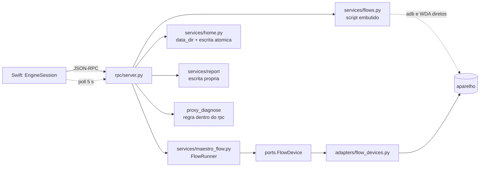

# Revisão de arquitetura: fronteira, motor, persistência e contrato · 2026-10-26

Papel: `arquitetura` (fase 2, somente leitura). Alvo: branch `melhoria/2026-10-26-rodada3`, HEAD `a74407c`, versão 3.11.0.
Método: critérios do `architecture-reviewer` aplicados para propor melhorias (não há diff), com o fluxo das skills `design-review`, `decomposition` e `playbook`.

## Limites da revisão (leia primeiro)

- Nesta sessão só havia `Read` por caminho. Sem `Glob`, `Grep` nem `Bash`: não listei diretórios, não contei imports e não localizei testes por busca. Onde digo "não existe", tentei ler o caminho exato e ele não existe; onde digo "não localizei", foi tentativa por nome.
- Nada foi executado (sem `make`, `swift test`, `pytest`). Toda evidência é **Verificado** (li o trecho exato hoje) ou **Inferido** (dedução do que li); marco cada uma.
- Revisão feita pelo mesmo modelo que escreveu parte do código: reduz erro, não é validação externa.
- Fora do meu recorte, recomendo outra área: redação do `Set-Cookie` em forma de dicionário no log bruto do CFNetwork (segurança), ver "Backlog" abaixo; desempenho do espelho (F1) e Swift 6 (R4) exigem build.

## Mapa do estado atual (resumo com evidência)

| Fato | Evidência | Rótulo |
|---|---|---|
| `rpc/server.py` tem 2.357 linhas e uma classe só (`EngineServer`) | `engine/src/mobaile/rpc/server.py:193-2357` | Verificado |
| O construtor instancia 14 adapters/serviços e guarda cerca de 35 campos de estado | `server.py:213-235`, `237-280` | Verificado |
| A tabela de métodos existe duas vezes (contrato e servidor), amarradas por teste de deriva | `rpc/contract.py:77-172` e `server.py:282-348`; docstring `contract.py:9-11` cita o teste | Verificado (o teste em si não li) |
| Regra de negócio dentro da camada `rpc`: diagnóstico de tráfego, escolha de backend de hierarquia, layout de pastas de salvar, máquina de estados da escuta passiva | `server.py:1321-1417`, `863-904`, `1556-1593` e `1918-1947`, `1748-1792` | Verificado |
| O servidor e outro adapter alcançam métodos privados de adapter irmão | `server.py:1715-1716` (`adb._run_cmd`, `_device_args`); `adapters/flow_devices.py:54` e `:109` (`adb._run_cmd`, `ios._ensure_session`) | Verificado |
| Atributos de estado nascem fora do `__init__` e são lidos por `getattr` | `server.py:900` e `917` (`_ultima_falha_de_hierarquia`); `1136` (`_proxy_notify_on`) | Verificado |
| Há dois executores de passos: o script Python embutido em `flows.py` (adb e WDA por conta própria) e o `FlowRunner` sobre a porta `FlowDevice` | `services/flows.py:113-408` e `428-516` contra `services/maestro_flow.py:668-736` e `ports/protocols.py:59-86` | Verificado |
| `services/flows.py` chama `adb` e `xcrun` direto (serviço que fura a camada de adapters) | `flows.py:5,46-48,66-77,85-86,96-97` | Verificado |
| A interface faz polling a cada 5 s e deriva o estado (ok, aviso, erro) em Swift | `apps/MoBaile/Sources/MoBaile/Engine/EngineSession.swift:560-591` | Verificado |
| A documentação afirma que a interface nunca faz polling | `docs/ARQUITETURA.md:64`; `docs/CONTEXTO_DO_PROJETO.md` (seção Arquitetura) | Verificado |
| `security/storage.py` não existe; quatro escritas em disco com quatro implementações diferentes | leitura do caminho falhou; `services/home.py:121-133`, `services/report/service.py:270-272` e `:322`, `server.py:1588` e `1944`, `adapters/ios_cfnetwork.py:433-449` | Verificado |
| O motor já persiste estado durável (`recentes.json`, com `version: 1`), mas `ARQUITETURA.md` descreve só estado em memória | `services/home.py:17-22,74-81,129`; `docs/ARQUITETURA.md:58-60` | Verificado |
| `data_dir()` mora em `services/home.py`, não em `config` nem `security` | `services/home.py:74-81` | Verificado |

Diagrama do que proponho mexer (Mermaid, 11 nós):

## Desafio de escopo

1. **Existe solução menor?** Para o executor de fluxo (ARQ-1), a menor é só emitir `flow.step` estruturado do script atual. Ela resolve M4, mas deixa o segundo executor e o segredo em arquivo. Registro como fase A da proposta.
2. **O que já existe e resolve parte?** `FlowRunner`, `FlowDevice`, `export_steps` e `selector_from_step` já existem e já convertem passo gravado em seletor (`maestro_flow.py:994-1020`, `1029-1064`). Falta só ligar `flow.run` a eles. `RecentStore._write` já é a escrita atômica que ARQ-2 generaliza.
3. **O que dá para não construir agora?** Não proponho decorator de registro de métodos (uniria `contract.py` e `methods`): `contract.py` precisa continuar barato de importar e legível por ferramenta externa (docstring `contract.py:12-14`). Também não proponho dividir `EngineSession.swift` agora (R2): sem build não dá para medir o risco.
4. **O que cada proposta cria?** ARQ-1 apaga mais do que cria. ARQ-2 cria 1 módulo e 1 ADR. ARQ-3 cria 1 notificação e 1 método aditivos. ARQ-4 cria 2 módulos de serviço e 1 teste de catraca. ARQ-5 cria 3 métodos aditivos (fora do corte).

## Propostas

Resumo (esforço P até 3 dias, M 1 a 2 semanas, G mais de 2 semanas):

| ID | Origem no backlog | Título | Esforço | Risco | Contrato RPC | Regra de negócio | Cabe no corte (6 melhorias, ~600 linhas) |
|---|---|---|---|---|---|---|---|
| ARQ-1 | M4, E3.3 (base), S2 (parte), PB4 | Um executor só: `flow.run` roda no `FlowRunner` e emite `flow.step` | M | Médio | Aditivo | Sim (muda como o replay espera e acha o elemento) | Sim, se contar linhas líquidas (apaga ~330) |
| ARQ-2 | S2, M10 e PB3/S3 (base) | Uma política de estado em disco: `security/storage.py`, `data_dir` fora de `home` e ADR 0006 | P | Baixo | Nenhum | Não | Sim (~180 linhas) |
| ARQ-3 | Decisão 3 de 14/10; doc contradiz código | Saúde do motor por notificação, sem polling nem derivação em Swift | P | Baixo | Aditivo | Não | Sim (~120 linhas) |
| ARQ-4 | R1, M9 | `server.py` por coesão: tirar regra do `rpc`, fechar acessos a privados, catraca | P (fase 1a) a M | Baixo na 1a | Nenhum | Não | Fase 1a sim (~250 linhas movidas); resto não |
| ARQ-5 | PB3, E2.5 | O motor passa a ser dono do documento de gravação | M | Médio | Aditivo | Sim (restaurar sessão após queda) | Não |

Ordem que recomendo: ARQ-2, depois ARQ-1, ARQ-3, ARQ-4 (fase 1a). ARQ-5 fica para a rodada seguinte e depende de ARQ-2.

---

### ARQ-1 · Um executor só: `flow.run` roda no `FlowRunner` e emite `flow.step`

**Origem:** M4 (progresso do fluxo), base de E3.3 (replay por localizador) e parte de S2 (segredo em arquivo).

**Problema.** Há dois executores do mesmo trabalho (tocar, digitar, esperar), com regras diferentes:

- `flow.run` gera um script Python como texto, grava em `$TMPDIR` e roda em subprocesso. O script reimplementa adb e WDA com `subprocess` e `requests`, toca só por coordenada e espera tempos fixos (`wait_between_steps(0.8)` e `(1.0)`). Evidência: `services/flows.py:113-408` (a f-string do script), `:398` (`wait_between_steps(1.0)`), `:243-253` (`adb shell input tap` direto). **Verificado.**
- `flow.maestro_run` roda em processo, sobre a porta `FlowDevice`, procurando o elemento por seletor (até 17 s), esperando a tela assentar e respeitando cancelamento. Evidência: `maestro_flow.py:36-47`, `668-736`, `814-823`. **Verificado.**
- O progresso do primeiro nunca chega à interface: o Swift procura `passo\s+(\d+)` no `flow.log` (`EngineSession.swift:1679`, `1738-1741`), e o script só escreve "passo N" na linha de falha (`flows.py:390,394`); no caminho feliz escreve `▶ [i/n]` e `Passo <var_name> concluído` (`:379,397`), que não casam. A barra fica parada. `NOTIFICATIONS` não tem `flow.step` (`contract.py:177-190`). **Verificado.**
- O texto digitado (inclusive senha) vai em claro para o arquivo do script (`flows.py:146,151,176`) e o caminho do script volta ao front (`server.py:1877`; `EngineDTO.swift:378-382`). Se o motor cair, o arquivo fica. **Verificado.**
- As pré-condições são checadas duas vezes: no servidor (`flows.py:28-110`, chamada em `server.py:1851`) e de novo dentro do script (`flows.py:205-239`). **Verificado.**

**Melhoria proposta.**

Fase A (independente, P): emitir `flow.step {run_id, index, total, var_name, status: started|passed|failed|cancelled, duration_ms}` e `result` em `flow.finished`. O Swift troca a regex por `case "flow.step"` e passa a mostrar "cancelado" (que hoje aparece como falha). É o M4 do backlog.

Fase B (M): `flow_run` deixa de gerar script e passa a montar um `Flow` em memória a partir de `codegen.get_steps()` (função nova `flow_from_steps` ao lado de `export_steps`, reaproveitando `selector_from_step`) e roda em `FlowThread`, com `Flow.secrets` mascarando o texto digitado. Para a Fase A valer nos dois caminhos, `FlowRunner._passo` (`maestro_flow.py:744-753`) ganha um callback `on_step`. Sai do repositório o script embutido (~330 linhas), `write_executable_script` para esse uso, o `FlowExecution` e a checagem duplicada de pré-condição; o `wm dismiss-keyguard` e o `keyevent 224` de `flows.py:66-77` passam para um método do `AndroidFlowDevice`.

Cuidados que fazem parte da proposta:

- Passo de digitação sem texto gravado continua recusado **antes** de começar (comportamento do PB1, hoje dentro do script em `flows.py:247-251`).
- `selector_from_step` lê o `locator_value` casando uma string formatada como código (`(AppiumBy.ID, '...')`) por regex (`maestro_flow.py:979,994-1020`). É acoplamento frágil: dois consumidores reanalisam um texto feito para exibição. Na Fase B, guardar `strategy` e valor bruto em campo estruturado do passo, ou ao menos cobrir com teste de ida e volta (Inferido: não vi o modelo `AutomationStep` em `domain/models.py`).
- Contrato: `flow.run` hoje responde `{running, steps, script}` e o Swift decodifica `script` como `String` obrigatória (`EngineDTO.swift:381`). Remover o campo seria mudança incompatível. Manter `script: ""` por uma versão e remover na próxima maior.

**Ganho.** Para quem usa: progresso que anda, cancelamento visível, replay que espera a tela e acha o elemento em vez de tocar coordenada cega (base de E3.3 e PB4). Para o código: um executor, menos 330 linhas, nenhum segredo em disco, o front deixa de interpretar texto de log.

**Esforço e risco.** Fase A: P. Fase B: M. Risco médio, porque o replay muda de comportamento (ver "Regra de negócio").

**Contrato RPC.** Aditivo: notificação `flow.step`, campo `result` e `run_id` em `flow.finished`, `run_id` em `flow.run`. `PROTOCOL_VERSION` continua 2. Exige `make fixtures` e `PROTOCOLO_RPC.md`.

**Regra de negócio: sim.** Passos gravados com estratégia `id` ou `xpath` passam a ser procurados na árvore (até 17 s) e falham se o elemento não estiver lá, em vez de tocar a coordenada. Isso segue a decisão já registrada em `RODADA_2026-10-05_PENDENCIAS.md` ("coordenada só vale quando a estratégia gravada é position"), mas muda o resultado visível para o usuário final. Precisa de decisão do dono (D-1 abaixo).

**Critério de aceite e verificação.**

1. Teste do motor com `FlowDevice` falso: 3 passos gravados geram 3 `flow.step` com `started` e `passed` na ordem, e `flow.finished.result == "passed"`. Falha hoje (não há `flow.step`).
2. Teste: `flow.stop` no passo 2 gera `flow.step` `cancelled` e `flow.finished.result == "cancelled"`; hoje o resultado só distingue sucesso de falha.
3. Teste: passo de digitação com texto sentinela roda sem criar nenhum arquivo em `secure_runtime_dir()` e sem o sentinela em `flow.log`, `flow.step` nem stdout (substitui o teste do PB1 `test_flow_execucao.py`).
4. Teste: passo `input` sem texto gravado faz `flow.run` responder `invalid_input` antes de ocupar o aparelho.
5. Swift: com `flow.step` real (fixture capturada da emissão), `currentRunStep` avança até o fim; a suíte falha hoje porque a regex só casa em falha.
6. Manual (roteiro de `QA.md`): gravar 3 passos num simulador e rodar; a barra avança.

---

### ARQ-2 · Uma política de estado em disco: `security/storage.py`, `data_dir` no lugar certo e ADR 0006

**Origem:** S2 (escrita atômica e privada), base para PB3 (sessão), S3 (registro do que o motor muda) e M10 (log do motor).

**Problema.** O motor guarda estado em disco, mas sem política única:

- `RecentStore._write` usa `mkstemp` + `os.replace` (`services/home.py:121-133`), sem `fsync`, sem modo 0600 explícito.
- `ReportService.update_card` usa um temporário de nome fixo + `os.replace` (`services/report/service.py:270-272`): colide se duas edições se cruzarem.
- `ReportService.export` e `codegen_save` e `flow_maestro_export` usam `write_text` direto: truncam e sobrescrevem; uma queda no meio deixa o Page Object ou o relatório pela metade (`report/service.py:322`; `server.py:1588`, `1944`).
- O log bruto do CFNetwork tem a sua própria rotina de permissão e rotação (`adapters/ios_cfnetwork.py:433-449`).
- `security/storage.py` não existe (leitura do caminho falhou). `secure_runtime_dir` ainda segue symlink e não confere o dono (`security/paths.py:21-29`).

Todos **Verificado**. Além disso:

- `data_dir()` mora em `services/home.py:74-81`. Qualquer módulo futuro que persista (sessão, registro de aparelho, log) teria de importar de `services.home`, o que inverte a dependência (adapter importando serviço). **Inferido** (ninguém importa ainda, que eu tenha visto).
- `docs/ARQUITETURA.md:58-60` e `CONTEXTO_DO_PROJETO.md` descrevem o estado do motor como memória que morre com o app. Desde a 3.11.0 isso não é inteiramente verdade (`recentes.json`). A pesquisa de 10/10 e a revisão de 14/10 tratavam o "primeiro estado persistido do motor" como pendência de ADR; ele já existe sem ADR (decisão estrutural sem registro). **Verificado.**

**Melhoria proposta.**

1. Criar `engine/src/mobaile/security/storage.py`, só com biblioteca padrão: `ensure_private_dir`, `write_atomic(path, data, *, mode=0o600, exclusive=False, owned=True)` (temporário no mesmo diretório, `fsync`, `os.replace`, `fsync` do diretório) e `PrivateRotatingLog`. Em diretório da pessoa (`~/Documents/Mo baile`), `owned=False`: escrever no caminho resolvido, sem recusar symlink (quem liga `pages/` ao repositório de testes não pode quebrar).
2. Mover `data_dir()` para `mobaile/config.py` (ou `security/paths.py`) e fazer `home.py` importar de lá.
3. Migrar os cinco pontos acima para a primitiva (cada um é troca de uma linha ou duas).
4. Escrever o **ADR 0006 "Estado em disco do motor"**, `proposto`: o que o motor pode persistir (recentes hoje; sessão e registro de aparelho depois), onde, com que permissão, com envelope versionado (`{schema, version}`), e a regra de que disco é evidência e recuperação, nunca estado vivo (princípio já adotado na pesquisa de 10/10).

**Ganho.** Para quem usa: Page Object e relatório deixam de ficar truncados numa queda ou disco cheio. Para o código: uma primitiva, o caminho aberto para PB3, S3 e M10 sem repetir a decisão cada vez.

**Esforço e risco.** P. Risco baixo; o único efeito colateral é `os.replace` trocar o inode (quem tem hard link para o `.py` deixa de vê-lo atualizado, raro).

**Contrato RPC.** Nenhum. **Regra de negócio.** Não (comportamento invisível, salvo o que deixa de corromper).

**Critério de aceite e verificação.**

1. Teste unitário da primitiva: com `os.replace` forçado a falhar, o arquivo anterior fica intacto e nenhum temporário sobra. Falha hoje para `codegen_save` (não há primitiva, e `write_text` trunca).
2. Teste: `mode` 0600 e diretório 0700; `exclusive=True` com destino existente dá erro.
3. Teste de contrato de `codegen.save`: sobrescrever Page Object existente com falha simulada no meio mantém o conteúdo anterior.
4. Teste: `RecentStore`, `update_card`, `export` e o log bruto passam pela primitiva (monkeypatch conta chamadas).
5. `make check` e ADR 0006 com `Status: proposto`, para o dono aceitar.

---

### ARQ-3 · Saúde do motor por notificação, sem polling nem derivação de estado em Swift

**Origem:** decisão 3 da revisão de 14/10 ("`engine.info.*_running` × a interface nunca faz polling"), ainda sem resposta no código.

**Problema.** A interface roda um laço de 5 s que chama `engine.info`, `wda.status` e `recording.status` e transforma booleanos em estado do rodapé: `adbAvailable ? .ok : .error`, `wdaRunning ? .ok : (appiumRunning ? .warn : .off)` (`EngineSession.swift:560-591`). Isso contradiz duas coisas escritas:

- `docs/ARQUITETURA.md:64`: "A interface nunca faz polling".
- A regra de ouro: a regra de estado (quando é aviso, quando é erro) está em Swift, e o motor já tem o vocabulário (`DaemonState` em `domain/models.py`, usado pelo diagnóstico em `services/diagnostics.py:20,35`).

Consequência prática: até 5 s de atraso para o rodapé refletir um proxy ligado ou uma gravação que parou, e a mesma regra de "aviso" teria de existir de novo em qualquer outro front. **Verificado** (leitura); o custo de CPU do laço é **Suposição** (as chamadas parecem baratas; `adb.is_available` só confere arquivo, `adapters/adb.py:77-79`).

**Melhoria proposta.** Método `engine.status` (aditivo) e notificação `engine.status_changed` com `{adb, wda, proxy, analytics, netlog, scrcpy, recording}` em valores de `DaemonState`. O motor emite na hora nas transições que ele mesmo conhece (início e fim de proxy, analytics, gravação) e, para o que só se descobre olhando (WDA, adb), roda um vigia curto no motor, à semelhança do `DeviceWatcher`, que só notifica quando algo muda. O Swift apaga `startWatchingDaemons` e `refreshDaemonStatus`, lê `engine.status` na conexão e na reconexão e reage à notificação.

**Alternativa que não muda código (opção "não mudar nada").** Corrigir `ARQUITETURA.md` e `CONTEXTO_DO_PROJETO.md` para dizer que o rodapé usa polling de 5 s. Barata, honesta, mas deixa a regra de estado no Swift.

**Ganho.** Rodapé sem atraso, regra de estado no motor, documentação verdadeira. **Esforço.** P. **Risco.** Baixo; o vigia é um thread a mais, e ele precisa respeitar `shutdown()` (padrão do `DeviceWatcher`, `services/devices.py:56-80`).

**Contrato RPC.** Aditivo (1 método, 1 notificação; atualizar `NOTIFICATIONS`, `PROTOCOLO_RPC.md`, `make fixtures`). **Regra de negócio.** Não (muda quando o rodapé acende, não o resultado de nenhum documento).

**Critério de aceite e verificação.**

1. Teste do motor: `proxy.start` e `proxy.stop` geram `engine.status_changed` com `proxy` em `ok` e `off`, sem esperar vigia.
2. Teste: WDA que passa de fora para dentro gera uma notificação, e nenhuma enquanto o estado não muda.
3. Teste do teste de deriva: `engine.status_changed` consta em `NOTIFICATIONS` e na fixture capturada da emissão real.
4. Swift: suíte com `engine.status_changed` atualiza `daemonStatus`; um teste garante que não há `Task.sleep` de polling em `EngineSession` (teste estático simples, hoje falha).

---

### ARQ-4 · `server.py` por coesão: tirar a regra do `rpc`, fechar o acesso a privados e travar o tamanho

**Origem:** R1 (servidor RPC dividido) e M9 (teste de camadas). A revisão de 14/10 desaconselhou dividir o arquivo "agora" por risco (1.806 linhas na época; hoje 2.357, +30%). Concordo com o risco da divisão por domínio de handler; proponho outra forma.

**Problema.** `EngineServer` mistura quatro papéis: despacho e filas (`server.py:101-190`, `2081-2331`), estado de sessão com época (`101-111`, `237-280`, `414-427`), ciclo de vida de recursos do aparelho (`1132-1266`: seis dicionários e conjuntos de proxy, trava, threads de retentativa) e **regra de negócio** que a camada `rpc` não deveria ter (`ARQUITETURA.md`: "rpc: valida e despacha"):

| Regra no `rpc` | Onde | Para onde iria |
|---|---|---|
| Causas de "por que não vejo tráfego" (97 linhas de regras sobre eventos) | `server.py:1321-1417` | `services/traffic_diagnosis.py`, função pura sobre eventos e flags |
| Política de backend de hierarquia Android (adb, depois Appium, memória por serial) | `server.py:863-904` | adapter/serviço `HierarchySource` (a porta já existe: `ports/protocols.py:44-47`) |
| Layout de pastas e colisão de nomes de salvar Page Object e flow | `server.py:1556-1593`, `1918-1947` | `services/workspace.py` (com `_dentro_de`, `server.py:188-190`) |
| Máquina de estados da escuta passiva (teclado, digitação, prefetch) | `server.py:1699-1811` | serviço de gravação passiva |

Dois sintomas de que a fronteira vazou, ambos **Verificado**: o servidor chama `self.adb._run_cmd` e `self.adb._device_args` (privados) em `server.py:1715-1716`, e `adapters/flow_devices.py:54` e `:109` fazem o mesmo com `adb` e `ios`. E estado nasce fora do `__init__`, lido por `getattr` (`server.py:900`, `917`, `1136`), o que esconde campo e impede checagem estática.

O `Makefile` só tem `ruff` (`Makefile:51-52`) e nenhum alvo de camadas ou tipos (**Verificado**); por isso nada barra o próximo acesso a privado ou o próximo crescimento. Não localizei teste de camadas (tentei `test_camadas.py` e `test_arquitetura.py`; sem busca não afirmo que não exista com outro nome).

**Melhoria proposta (fase 1a, a que cabe no corte).**

1. Extrair `proxy_diagnose` para `services/traffic_diagnosis.py` como função pura (o servidor só reúne os dados e chama). A fixture `proxy.diagnose` e o teste atual não mudam.
2. Extrair o layout de salvar para `services/workspace.py` (`save_page_objects`, `export_flow_path`). Combina com ARQ-2.
3. Dar ao adapter os métodos que faltam (`ADBBridge.is_keyboard_shown(serial)`, `IOSBridge.ensure_session()` público) e trocar os quatro acessos a privados.
4. Declarar no `__init__` os três atributos que hoje nascem por `getattr`.
5. Catraca: teste que falha se `server.py` passar de um teto de linhas (começar em 2.357 e só diminuir) e se alguém fora de `adapters/` chamar `adb._...` ou `ios._...`. Isso entrega o M9 na parte que dá para verificar por leitura de texto.

**Fase 1b (não cabe, M):** mover o ciclo de vida do proxy (`1132-1266`) para um objeto próprio, mantendo a ordem de travas já documentada em `services/devices.py:66-69` (trava do vigia antes da trava de estado). Só depois de ARQ-2, porque o registro durável futuro (S3) vai morar ali.

**O que não faço de propósito:** registro por decorator que una `contract.METHODS` e `EngineServer.methods`. O contrato é intencionalmente barato de importar e legível por ferramenta externa (`contract.py:12-14`); unir os dois puxaria os handlers para dentro dele.

**Ganho.** Para o código: regra testável sem subir o servidor, fronteira de adapter respeitada, teto que impede a próxima fonte de dívida. **Esforço.** P a M. **Risco.** Baixo na 1a (movimento sem mudança de comportamento).

**Contrato RPC.** Nenhum. **Regra de negócio.** Não (comportamento idêntico).

**Critério de aceite e verificação.**

1. Os testes existentes de `proxy.diagnose`, `codegen.save` e `flow.maestro_export` passam sem edição (prova de que não mudou comportamento) e `make fixtures-check` fica verde.
2. Teste novo de `traffic_diagnosis.diagnose` sem `EngineServer`: cada causa com um caso mínimo. Falha hoje porque a função não existe fora do servidor.
3. Teste de catraca: falha se `server.py` crescer e se houver `adb._` ou `ios._` fora de `adapters/`. Falha hoje para os quatro acessos listados.

---

### ARQ-5 · O motor passa a ser dono do documento de gravação (PB3)

**Origem:** PB3 (sessão que sobrevive ao reinício), E2.5 (quadro e árvore com o mesmo `snapshot_id`).

**Problema.** Os passos gravados e o código gerado têm duas cópias que divergem numa queda do motor:

- O motor guarda passos e nomes já usados só em memória (`services/codegen.py:75-77`, `server.py:1996-2001`).
- O Swift acumula o texto do Page Object por concatenação (`state.locatorsCode += ...`, `EngineSession.swift:1079-1080` e `1658-1659`) e os editores são editáveis; `codegen.save` grava o que está na tela (`server.py:1556-1593`).
- Depois de uma queda, `restore` religa aparelho e espelho, mas não toca em passos nem em editores (`EngineSession.swift:517-549`). Resultado, por leitura: a tela mostra a lista antiga; `flow.run` responde "Nenhum passo gravado" (`server.py:1822-1824`); e o motor novo, com `declared_objects` vazio, pode gerar de novo `BOTAO_X`, que o editor do front já contém, gravando atributo duplicado no Page Object salvo (`codegen.py:172-175`). **Inferido** (não executei a sequência).
- `codegen.steps` devolve `input_text` em claro ao front (`EngineDTO.swift:285`). Combina com o ponto de segurança já listado para a área de segurança.
- A época da sessão existe no motor (`server.py:101-111`, `414-427`), mas não viaja nas respostas; o front mantém contadores próprios (`EngineSession.swift:144-149`). **Verificado.**

**Melhoria proposta.** Seguir o desenho já escrito no apêndice A §2 de `RODADA_2026-10-05_PENDENCIAS.md` (documento de sessão v1, `session.save`, `session.restore` explícito, "desarmado" até a pessoa agir), apoiado na primitiva de ARQ-2, com `sensitive` por passo para o texto digitado não ir ao disco. Passo intermediário barato (P): `codegen.record` e `passive.step` devolvem também a chave de `declared_objects`, e `session.select_device`/`engine.hello` devolvem a época, para o front deixar de manter geração própria.

**Esforço e risco.** M; médio, porque cria o primeiro estado do motor que a pessoa pode restaurar. Depende de ARQ-2 (primitiva e ADR 0006).

**Contrato RPC.** Aditivo (`session.save`, `session.restore`, campos novos). **Regra de negócio.** Sim: o que reaparece depois de uma queda. **Cabe no corte.** Não.

**Critério de aceite.** Teste do motor: gravar 2 passos, `session.save`, motor novo, `session.restore`, `codegen.steps` devolve os 2 e o próximo `codegen.record` não repete nome. Teste: passo `sensitive` não leva `input_text` ao arquivo. Falham hoje (os métodos não existem).

---

## Decisões pendentes do humano (D-n)

| ID | Pergunta | Recomendação | Dono | O que bloqueia |
|---|---|---|---|---|
| D-1 | O replay dos passos gravados pode passar a procurar o elemento por seletor e esperar a tela assentar, em vez de tocar coordenada com espera fixa? | Sim, só para estratégia `id` e `xpath`; `position` segue coordenada. Confiança média: muda resultado para quem usa | Francisco Edson Ferreira Junior | ARQ-1 fase B |
| D-2 | Registrar o ADR 0006 declarando que o motor pode ter estado durável (recentes já existem)? | Sim, como `proposto`, antes de PB3 e S3. Confiança alta | Francisco Edson Ferreira Junior | ARQ-2, ARQ-5 |
| D-3 | Saúde do rodapé: o motor empurra (ARQ-3) ou aceitamos o polling e corrigimos o texto da documentação? | Empurrar, porque o ganho é o rodapé sem atraso e a regra no motor. Alternativa válida: só corrigir a documentação. Confiança média | Francisco Edson Ferreira Junior | ARQ-3 |

## Backlog da minha área: resolvido, parcialmente resolvido ou que não se sustenta

| ID | Estado | Evidência |
|---|---|---|
| R1 (servidor dividido por domínio) | Aberto; cresceu. Proponho outra forma (ARQ-4) | `server.py` termina na linha 2357; era 1.806 em 14/10 (`propostas-priorizadas.md`) |
| R2 (`EngineSession` por funcionalidade) | Aberto, 1.760 linhas; não proponho agora (sem build não meço o risco). Candidato mais seguro quando vier: tirar a supervisão do motor (`EngineSession.swift:107-139`, `195-549`), que é uma máquina de estados com política própria | `EngineSession.swift` termina na linha 1760 |
| R3 (porta `DebugTrafficSource`) | Aberto, prioridade baixa. A porta `TrafficSource` existe (`ports/protocols.py:90-100`), mas os dois adapters de debug são construídos e parados em separado (`server.py:219-223`, `1304-1307`) e `netlog_start` ramifica por plataforma (`1277-1302`) | Verificado |
| R4 (Swift 6 estrito), R5 (estudo Android) | Não reconferi: exigem build ou estudo | Não verificável |
| M9 (camadas por AST) | Aberto, e a exceção de `flows.py` ainda existe (`flows.py:5,46-48`); entra na catraca de ARQ-4 | Verificado |
| M3 (fixtures das notificações) | Parcial: `stream.frame` e `$/progress` agora saem da emissão real (`tools/generate_fixtures.py:329-359`); `proxy.event` e `analytics.event` ainda são montados por `to_dict()` (`:361-377`). Sem fixture: `stream.settled`, `device.changed`, `home.changed`, `passive.*`, `flow.log`, `flow.finished` (4 de 12 cobertas) | Verificado |
| M4 (progresso do fluxo) | Aberto; ARQ-1 | `EngineSession.swift:1679,1738-1741`; `contract.py:177-190` |
| M10 (log do motor em arquivo) | Aberto: `serve()` só configura stderr; erro interno devolve traceback sem identificador | `server.py:2334-2341`, `2132-2137` |
| S1 (log bruto do CFNetwork) | Parcial: URL passa por `redact_url`, pasta 0700 e arquivo 0600 já estão no código. **Inferido** que `Set-Cookie` em forma de dicionário (`"Set-Cookie" = ( ... );`) segue sem máscara, porque `_HEADER_LINE` exige começar por letra ou dígito (`ios_cfnetwork.py:71`, `317-331`, `433-449`). Passar à área de segurança, que pode executar o parser | Verificado (trecho) / Inferido (efeito) |
| S2 (escrita atômica) | Aberto; ARQ-2 e parte em ARQ-1 | `security/storage.py` ausente; `flows.py:146,151,176` |
| S3 (registro do que o motor muda) | Em memória sim (`server.py:258-267`, `1140-1226`), em disco não. Depende de ARQ-2 e do ADR 0006 | Verificado |
| PB3 (sessão após reinício) | Aberto; ARQ-5 | `contract.py:77-172` não tem `session.save` |
| E2.5 (`snapshot_id`) | Aberto; passo barato dentro de ARQ-5 | `server.py:101-111`; `EngineSession.swift:144-149` |
| A5 (auditar por linha de comando) | Não proponho. A base existe: `python -m mobaile.rpc` roda o motor sem janela (`Makefile:74-75`), e `ReportService` não toca aparelho; um `mobaile.cli audit` fino é P, com saída 2 em divergência | Inferido |
| Item da pesquisa 10/10: "ramo `output_path` morto em `flows.py`" | Ainda existe (`flows.py:414-419`); some junto com ARQ-1 fase B | Verificado |

## Observações que não viraram proposta

- `startStream` fixa `fps: 6.0` e `max_width: 900` no Swift (`EngineSession.swift:854`), enquanto o motor tem `settings.stream_fps` e `STREAM_MAX_WIDTH` (`server.py:91`). Duplicação pequena de configuração; vira defeito se alguém mudar só um lado.
- Exportadores de HAR, cURL, trecho Python e do JSON de Analytics são montados no Swift (`App/Exporters.swift:19-125`), e o `log_obtido.json` é o formato que `report.audit source=file` lê no motor: um contrato implícito sem fixture. O comentário de `server.py:2012` diz que o histórico da sessão é "o mesmo conteúdo" do export, mas o front corta em 1.000 eventos (`EngineSession.swift:1725-1733`) e o motor guarda 5.000 (dado da pesquisa de 10/10; não reconferi o `maxlen`). Candidato à rodada seguinte: `analytics.export` no motor, devolvendo caminho.
- `ports.AnalyticsSource.start(platform, device_id)` (`ports/protocols.py:109`) já não descreve `FirebaseAnalyticsListener.start(..., package_name, ios_physical)` (`server.py:1427-1429`). Os `Protocol` são `runtime_checkable`, mas sem verificador de tipo no portão (`Makefile:51-52`) a divergência não aparece. Se a decisão for manter as portas, vale um teste de conformidade por assinatura; se não, remover as que ninguém usa.

## Limites e próximos passos

- Rodar `make check` e `make test-swift` antes de implementar qualquer item; esta revisão não os executou.
- Cada item que toca `engine/src` ou `apps/MoBaile` termina com `make update-native` e o OK do `verify-native` (regra do `AGENTS.md`), com o app fechado pelo dono.
- Item que muda contrato (ARQ-1, ARQ-3, ARQ-5) pede `make fixtures`, `PROTOCOLO_RPC.md` e versão nova (minor, por ser aditivo).
- Sugestão de especialistas para o que ficou de fora: segurança (`Set-Cookie` do CFNetwork, `input_text` em claro em `codegen.steps`), QA (cobertura de fixtures das notificações e teste de conformidade das portas).
